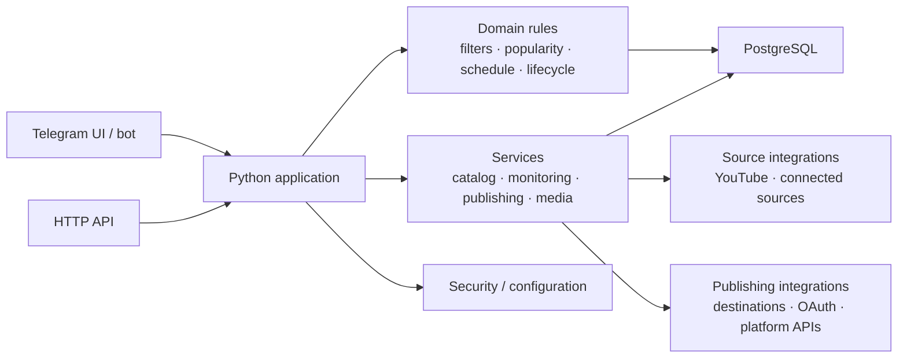
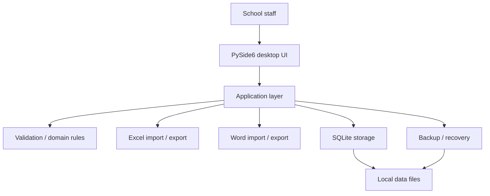
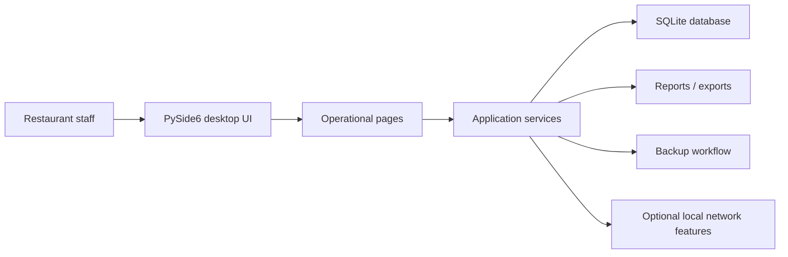
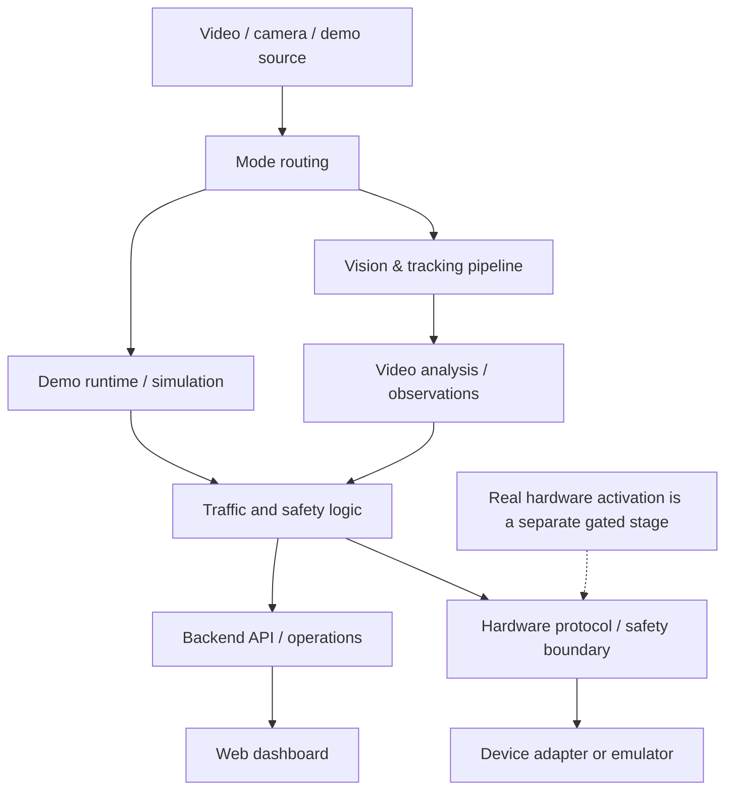
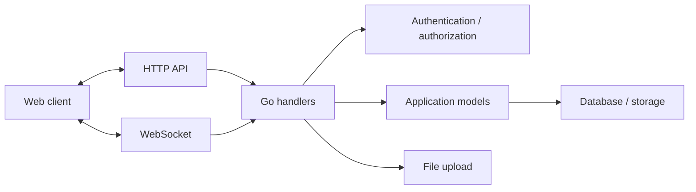
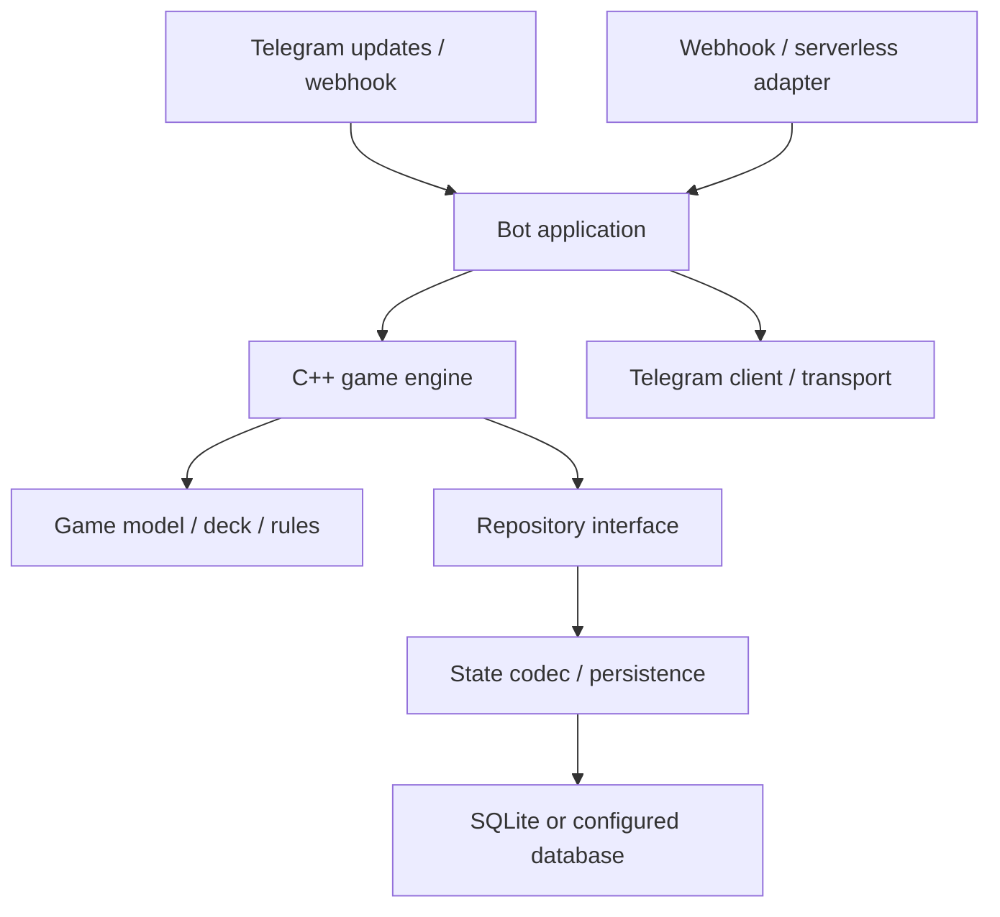
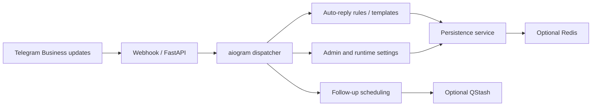
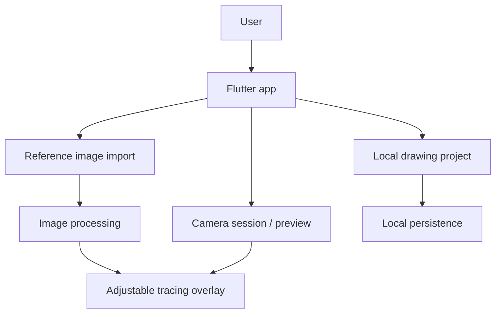

# Project Architecture Atlas

A GitHub-native architecture guide for selected public repositories by [Krekker0101](https://github.com/Krekker0101). Mermaid diagrams render directly in GitHub. These maps describe visible source boundaries and documented workflows; they do not claim all repositories form one platform or that every feature is production-deployed.

## 1. PULSE — social-content automation

[Repository](https://github.com/Krekker0101/PULSE)

Domain rules, services, source integrations, publishing integrations, and persistence are separate concerns. Media discovery, retention, permissions, and publishing are not the same workflow.

<strong>Source map</strong>

- `backend/app/domain/` — filtering, popularity, scheduling, lifecycle, destinations.
- `backend/app/services/` — catalog, source monitoring, publishing, media, worker workflows.
- `backend/app/integrations/` — YouTube, Telegram, social platforms and publishing.
- `backend/app/api.py`, `backend/app/bot.py` — application entry surfaces.
- `backend/app/models.py`, `backend/app/db.py` — persistence models and database access.

## 2. MaktabOS — local school register

[Repository](https://github.com/Krekker0101/MaktabOS)

Designed to work locally without a permanent internet connection. Import/export, validation, persistence, and recovery have distinct modules.

<strong>Source map</strong>

- `schoolregister/app.py` — desktop application.
- `schoolregister/storage.py` — local persistence.
- `schoolregister/validation.py` — data validation.
- `schoolregister/excel.py`, `schoolregister/word.py` — document workflows.
- `schoolregister/backup.py`, `schoolregister/recovery.py` — backup and recovery.

## 3. Noz-Bogh POS — restaurant operations

[Repository](https://github.com/Krekker0101/Noz-Bogh)

A native desktop POS with local database storage. The source separates database access, service operations, UI pages, localization, and styling.

<strong>Source map</strong>

- `app/main_window.py`, `app/pages.py` — window and pages.
- `app/services.py` — application operations.
- `app/database.py` — database access.
- `app/network.py` — network-related functionality.
- `app/i18n.py` — localization.

## 4. RohAI — smart traffic and computer vision

[Repository](https://github.com/Krekker0101/RohAI)

Demo/simulation, video analysis, and hardware-facing paths are distinct. Repository documentation treats physical road activation as a separate gate; this diagram does not imply live traffic control is deployed.

<strong>Source map</strong>

- `apps/backend/src/smart_traffic_backend/` — runtime, mode routing, AI, video analysis, safety and hardware boundaries.
- `apps/dashboard/src/` — frontend views, data access and feature panels.
- `apps/dashboard/src/data/` — API/backend adapters and telemetry source handling.
- `docs/` — pilot, validation, and operation documentation.

## 5. LinkUp — communication platform

[Backend](https://github.com/Krekker0101/LinkUp) · [Frontend](https://github.com/Krekker0101/LinkUp-frontend)

The backend separates app setup, handlers, auth, models, storage, and utilities. The frontend is maintained in a separate repository.

## 6. Bunker — game engine and Telegram transport

[Repository](https://github.com/Krekker0101/Bunker)

Game rules/state are separated from Telegram transport and persistence. Native C++ components are paired with webhook/serverless adapters and tests.

## 7. ChatPilot — Telegram Business auto-replies

[Repository](https://github.com/Krekker0101/ChatPilot)

Webhook entry points, bot handlers, application services, security, settings, and scheduling are separate concerns. Redis and QStash are optional integrations; guarantees depend on configuration.

## 8. Scetch — local camera tracing

[Repository](https://github.com/Krekker0101/Kashak)

The source tree separates app bootstrap/routing, camera handling, image processing, and local project persistence. Project documentation notes that production readiness and all validation steps should not be assumed complete.

---

## Keep diagrams accurate

When a project changes, update its diagram alongside its architecture docs. Prefer clear boundaries and data flow over decoration. All diagrams are Mermaid rendered by GitHub; no external diagram service, JavaScript, or analytics embed is required.

