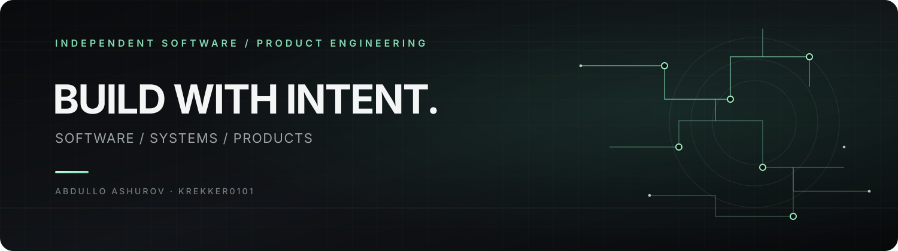

  

# Abdullo Ashurov

**Software Engineer · Systems Architecture · Product Engineering**

I build independent software projects focused on practical problems — from offline-first desktop applications to automation platforms and systems that explore more complex workflows.

I care about the engineering behind a product: clear structure, reliable behavior, maintainable code, and decisions that make software useful beyond the first demo.

**BUILD WITH INTENT. ENGINEER WHAT MATTERS.**

---

## 01 / Selected Work

### [MaktabOS](https://github.com/Krekker0101/MaktabOS)
An offline-first school management application and student information system for maintaining local student records, with Excel and Word import/export workflows. Built with Python, PySide6, and SQLite.

### [Noz-Bogh POS](https://github.com/Krekker0101/Noz-Bogh)
A desktop point-of-sale system for restaurant operations, including table and order management, kitchen workflow, payments, administration, backups, and reporting — designed to work locally without a permanent cloud connection.

### [PULSE](https://github.com/Krekker0101/PULSE)
A Telegram-managed social media automation project for monitoring YouTube videos and Shorts, analyzing engagement, applying content filters, and managing publishing workflows for supported platforms.

### [RohAI — Smart Traffic AI](https://github.com/Krekker0101/RohAI)
A traffic-intelligence and computer-vision project exploring video analysis, object tracking, simulation, and observation-first workflows for smart-intersection systems. Simulation and real-world hardware activation are treated as separate stages.

### [LinkUp](https://github.com/Krekker0101/LinkUp) · [Frontend](https://github.com/Krekker0101/LinkUp-frontend)
A web communication-platform project exploring real-time messaging, user access, and the separation of backend services from the frontend.

### [Scetch](https://github.com/Krekker0101/Kashak)
A Flutter camera-tracing and drawing app concept for placing a reference image over a live camera view and adjusting it while drawing by hand.

---

## 02 / Engineering Focus

- **Product engineering** — shaping ideas into practical software.
- **System design** — keeping components understandable and responsibilities clear.
- **Offline-first software** — building tools that remain useful without depending on a permanent internet connection.
- **Automation** — reducing repetitive work through focused software workflows.
- **Reliability and maintainability** — prioritizing predictable behavior and long-term clarity.

## 03 / Tools Across My Projects

`Python` · `Go` · `C++` · `TypeScript` · `JavaScript` · `Dart`  
`SQLite` · `PostgreSQL` · `PySide6 / Qt` · `React` · `Docker`

*The tools vary by project. The goal stays the same: choose a suitable approach and build something useful.*

## 04 / Principles

- Clarity over unnecessary complexity.
- Products over empty promises.
- Thoughtful architecture over quick patches.
- Useful outcomes over decoration.
- Keep learning by building and refining real projects.

---

  <strong>BUILD WITH INTENT.</strong> 
  Less noise. Better systems. Meaningful products.

