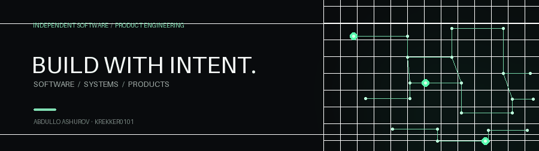
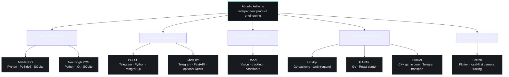

<!-- GitHub-native Mermaid diagrams, collapsible details, and a locally stored animated banner. -->

<h1 align="center">Abdullo Ashurov</h1>

<strong>Software Engineer · Systems Architecture · Product Engineering</strong> Building independent products through thoughtful engineering.

<code>PRODUCTS</code> · <code>SYSTEMS</code> · <code>AUTOMATION</code>

<a href="#architecture-at-a-glance">Architecture</a> · <a href="#selected-work">Selected work</a> · <a href="ARCHITECTURE.md">Deep-dive diagrams</a>

---

## Architecture at a glance

This map groups my public repositories by problem space. It does **not** imply that these projects are one connected platform.

<strong>How to read this map</strong>

- **Offline-first desktop:** local workflows and data storage are central to MaktabOS and Noz-Bogh POS.
- **Automation:** PULSE focuses on content discovery and publishing workflows; ChatPilot focuses on Telegram Business auto-replies and administration.
- **Vision systems:** RohAI separates dashboard, analysis/simulation, and guarded hardware-facing workflows.
- **Communication and web:** LinkUp, GAPAK, and Bunker explore different application and service boundaries.
- **Mobile tools:** Scetch focuses on camera-assisted tracing with local project storage.

Arrows group projects by purpose; they do not imply repository dependencies.

---

## Selected work

| Project | Focus | Technologies |
|---|---|---|
| [**MaktabOS**](https://github.com/Krekker0101/MaktabOS) | Offline school register, student records, Excel/Word import and export | Python · PySide6 · SQLite |
| [**Noz-Bogh POS**](https://github.com/Krekker0101/Noz-Bogh) | Desktop restaurant POS, kitchen workflow, payments, backups and reporting | Python · PySide6 · SQLite |
| [**PULSE**](https://github.com/Krekker0101/PULSE) | Telegram-managed YouTube discovery, engagement analysis, filtering and publishing workflows | Python · Telegram · PostgreSQL |
| [**ChatPilot**](https://github.com/Krekker0101/ChatPilot) | Telegram Business auto-reply assistant, admin tools and optional state/scheduling integrations | Python · FastAPI · aiogram |
| [**RohAI**](https://github.com/Krekker0101/RohAI) | Smart-traffic exploration with video analysis, tracking, simulation and dashboard | Python · computer vision · TypeScript |
| [**LinkUp**](https://github.com/Krekker0101/LinkUp) · [Frontend](https://github.com/Krekker0101/LinkUp-frontend) | Communication platform exploring real-time messaging and separated backend/frontend | Go · TypeScript |
| [**Bunker**](https://github.com/Krekker0101/Bunker) | Telegram social game with C++ game engine and separated persistence/transport | C++ · SQLite · Telegram |
| [**GAPAK**](https://github.com/Krekker0101/GAPAK) | Go + React web application starter focused on auth and application structure | Go · React · PostgreSQL |
| [**Scetch**](https://github.com/Krekker0101/Kashak) | Camera tracing and drawing app with adjustable overlays and local projects | Flutter · Dart · SQLite |

[**Explore all public repositories →**](https://github.com/Krekker0101?tab=repositories) · [**Open the architecture atlas →**](ARCHITECTURE.md)

## Engineering principles

- **Clarity over accidental complexity.**
- **Products over empty promises.**
- **Architecture that can evolve.**
- **Local-first when it improves control and resilience.**
- **Real implementation, documented limitations, and incremental refinement.**

<strong>BUILD WITH INTENT.</strong> Less noise. Better systems. Meaningful products.

